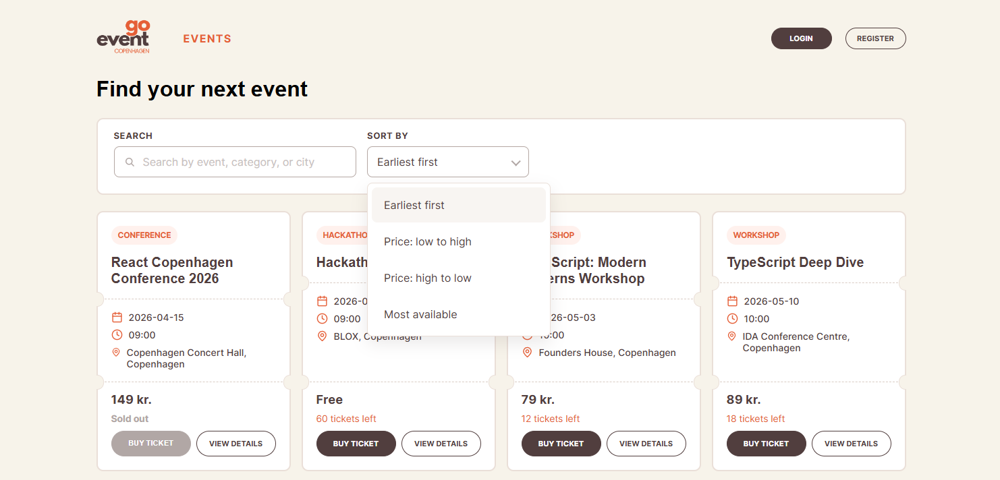
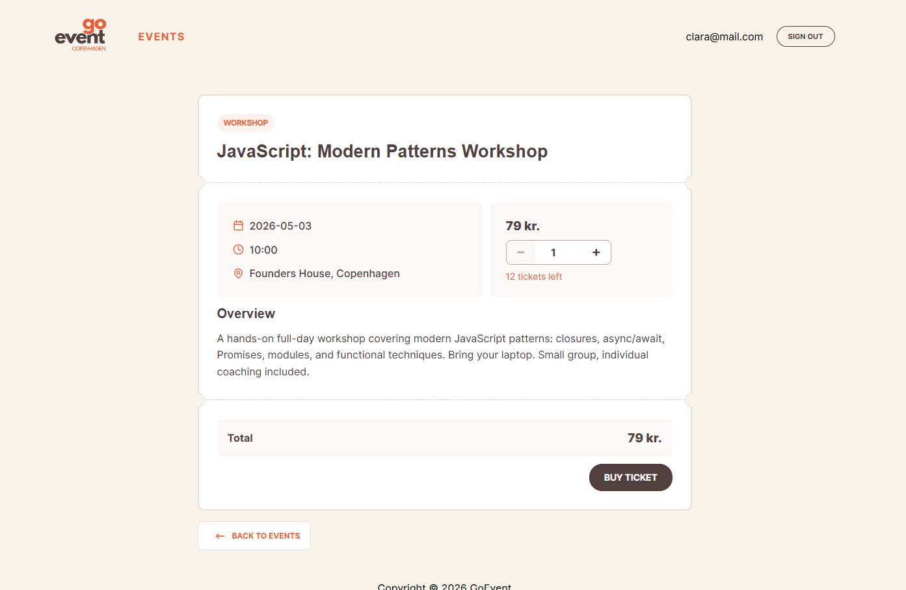
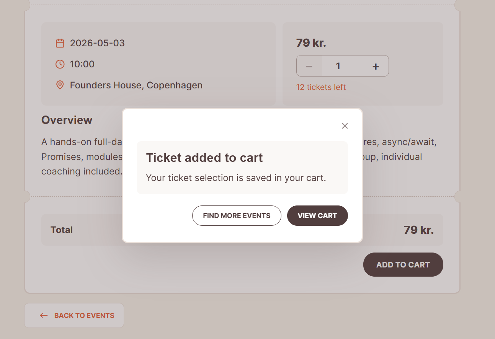
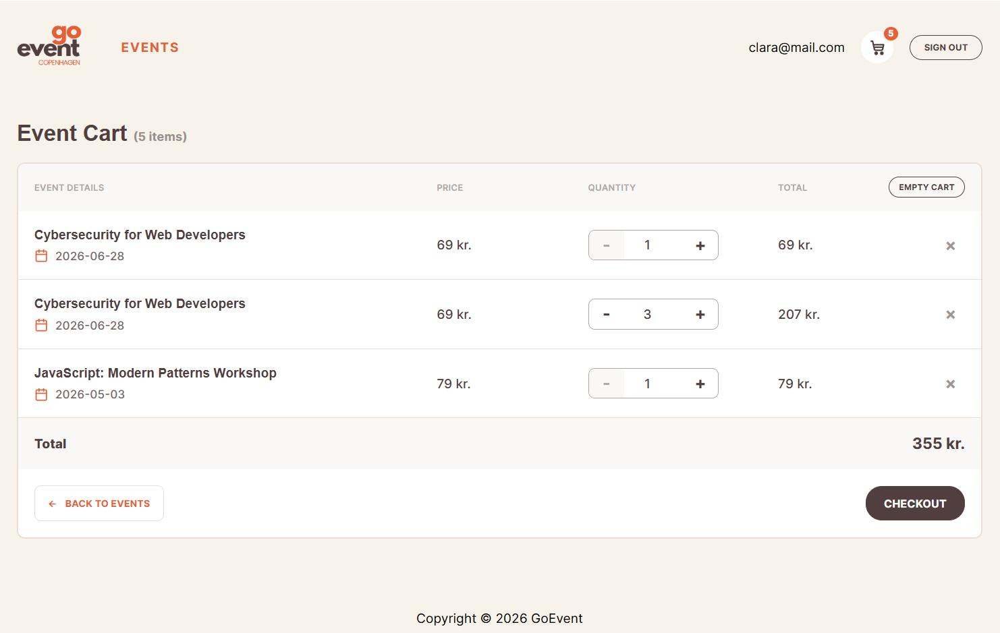
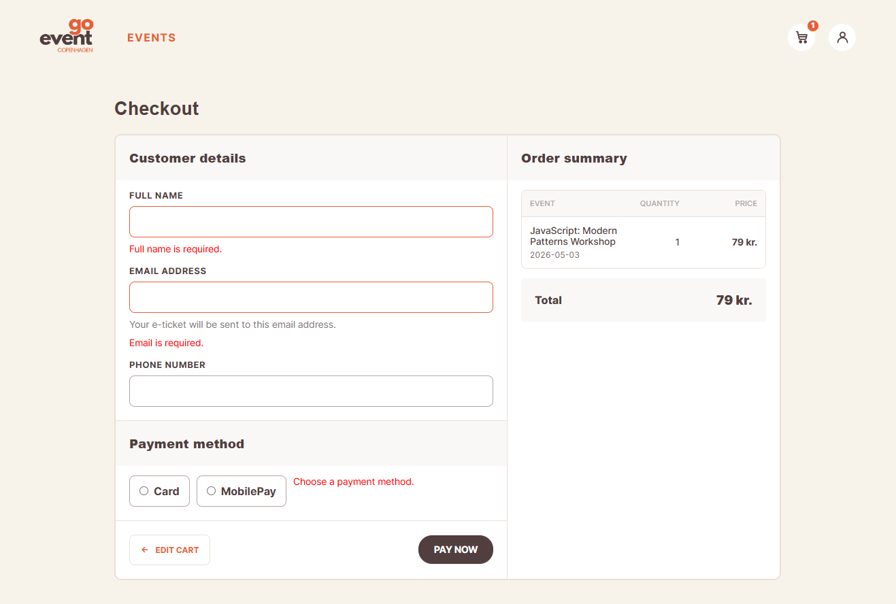
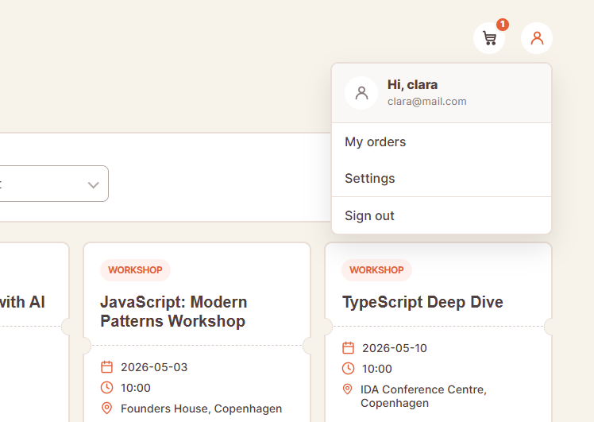
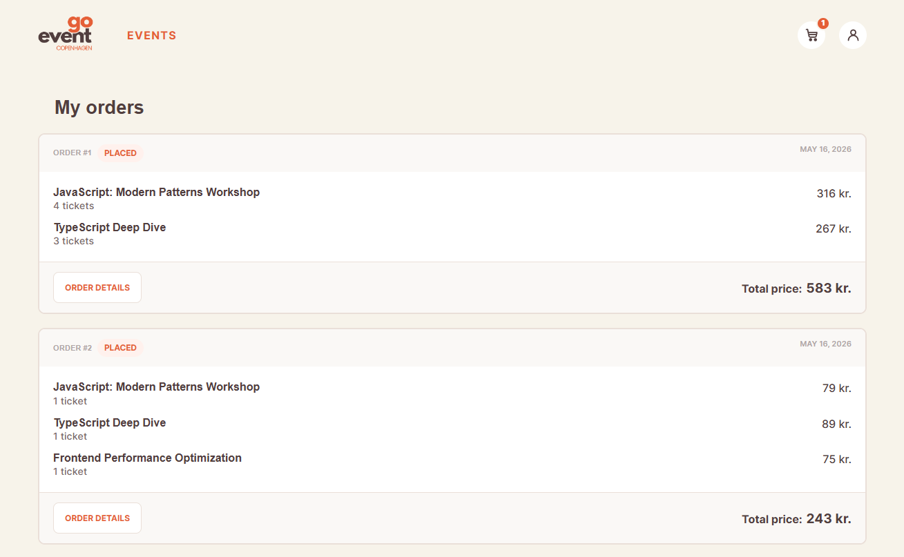
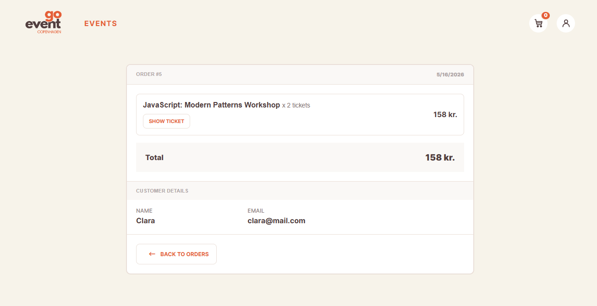

# GoEvent Copenhagen — Ticketing Platform

GoEvent Copenhagen is a ticketing platform for browsing tech events in Copenhagen, viewing event details, adding tickets to a cart, checking out, and reviewing placed orders.

The project was built as a frontend-focused React application with authentication, protected user flows, cart management, checkout validation, and order history.

## Live Demo

[Open deployed app](https://ticketing-platform-plum.vercel.app/)

## Repository

[GitHub repository](https://github.com/Iryna-git-hub/Ticketing_platform)

---

## Preview


### Home page


### Events listing with search and sorting



### Event details



### Add to cart modal



### Cart



### Checkout



### User menu and order history





### Order details



---

## Project Overview

GoEvent Copenhagen helps users find and buy tickets for tech-related events such as workshops, meetups, conferences, bootcamps, and hackathons.

The main user flow is:

1. Browse available events.
2. Search or sort events.
3. Open an event details page.
4. Choose ticket quantity.
5. Add tickets to the cart.
6. Review and update cart items.
7. Complete checkout.
8. View order history and order details.

The app focuses on a clear event discovery and ticket-purchase experience, while also demonstrating real application concerns such as routing, authentication, protected pages, form validation, persistent session state, and API integration.

---

## Features

### Event browsing

Users can browse a list of available events. Each event card shows the category, event title, date, time, location, price, and ticket availability.

### Search and sorting

Users can search events by title, category, or city. They can also sort events by:

- earliest date first;
- price from low to high;
- price from high to low;
- most available tickets.

### Event details page

Each event has a details page with extended information, including:

- event category;
- date;
- time;
- location;
- ticket price;
- available ticket count;
- event overview;
- ticket quantity selector;
- calculated total price.

### Authentication

Users can register, log in, and sign out. After login, the application displays the user state in the header and unlocks authenticated user actions.

### Cart

Users can add tickets to the cart, see the cart item count in the header, change quantities, remove items, empty the cart, and review the total price before checkout.

### Checkout

The checkout page includes customer details, payment method selection, order summary, and form validation. The user must provide required information before placing an order.

### Orders

Authenticated users can view their order history and open individual order details. The order details page shows purchased tickets, total price, and customer information.

---

## Tech Stack

- React
- Vite
- React Router
- JavaScript
- CSS
- Mock REST API with `json-server`
- Authentication with `json-server-auth`
- Local storage for session/cart persistence
- Vercel deployment

---

## Project Structure

```text
Ticketing_platform/
├── api/
│   └── ...
├── app/
│   ├── api/
│   ├── public/
│   ├── src/
│   │   ├── components/
│   │   ├── context/
│   │   ├── pages/
│   │   └── ...
│   ├── .env.example
│   ├── package.json
│   └── vite.config.js
├── images/
│   └── readme/
└── README.md
```

---

## Getting Started

### 1. Clone the repository

```bash
git clone https://github.com/Iryna-git-hub/Ticketing_platform.git
cd Ticketing_platform
```

### 2. Install app dependencies

```bash
cd app
npm install
```

### 3. Create environment file

```bash
cp .env.example .env
```

Make sure the API URL is configured correctly in `.env`.

For local development with the mock API, use:

```env
VITE_API_URL=http://localhost:3001
```

### 4. Run the app and mock API

```bash
npm run dev:all
```

This starts both the Vite frontend and the mock API.

Alternatively, run them in separate terminals:

```bash
npm run dev
npm run api
```

Default local URLs:

```text
Frontend: http://localhost:5173
Mock API: http://localhost:3001
```

---

## API Overview

The project uses a mock REST API for events, authentication, and orders.

Main endpoints:

| Method | Endpoint | Auth required | Description |
|---|---|---:|---|
| `GET` | `/events` | No | Get all events |
| `GET` | `/events/:id` | No | Get single event details |
| `POST` | `/register` | No | Create user account |
| `POST` | `/login` | No | Log in and receive access token |
| `GET` | `/orders` | Yes | Get user orders |
| `POST` | `/orders` | Yes | Place an order |
| `PATCH` | `/orders/:id` | Yes | Update an order |
| `DELETE` | `/orders/:id` | Yes | Delete an order |

Protected requests use the access token:

```js
Authorization: Bearer <accessToken>
```

---

## Authentication

Authentication is managed through `AuthContext`.

The app stores the logged-in user and token in state and persists the session in `localStorage`, so the user remains logged in after refreshing the page.

This was a practical choice for the project because it keeps the auth flow simple and easy to test. 

---

## Main User Flow

```text
Events page
   ↓
Search / sort events
   ↓
Open event details
   ↓
Select ticket quantity
   ↓
Add to cart
   ↓
Review cart
   ↓
Checkout
   ↓
Place order
   ↓
View order in My Orders
```

---

## What I Focused On

The main focus of this project was to build a complete user journey instead of isolated UI screens.

Important implementation points:

- reusable layout and UI components;
- routing between pages;
- event filtering and sorting;
- login/register flow;
- protected order functionality;
- cart state and cart quantity updates;
- checkout form validation;
- order creation and order details;
- clear visual design matching the GoEvent brand style.

---

## Challenges and Learnings

One of the main challenges was connecting several parts of the app together: routes, API calls, authentication state, cart state, and protected order actions.

The project helped me better understand:

- how to structure a React application;
- how to manage global auth state with Context;
- how to work with a mock API;
- how to avoid hardcoded API URLs by using environment variables;
- how to keep UI state and API data consistent;
- how to design a complete user flow from browsing to checkout.

---

## Future Improvements

Possible next steps:

- replace the mock API with a production backend;
- add real payment integration;
- add admin functionality for creating and editing events;
- add stronger backend validation;
- improve ticket availability logic;
- add loading skeletons and more detailed error states;
- improve responsive layouts for smaller screens;
- add automated tests for cart, checkout, and authentication flows.

